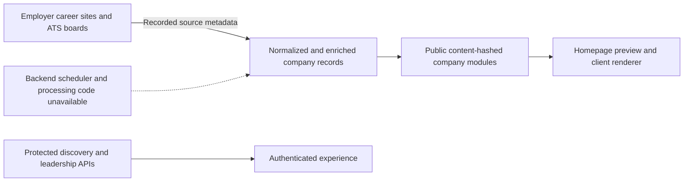

# Nextdoor.company reverse engineered

[](https://github.com/MacintoshTavish/Nextdoor.company-reverse-engineered/actions/workflows/checks.yml)

A public-source audit of **[nextdoor.company](https://www.nextdoor.company/)**: where its listings come from, how fresh its published data is, which failures can be reproduced, and what the operator can fix.

**Snapshot: 28 September 2026.** This repository records observations from that date, not a continuously updated claim about the live site. It is independent research, not the operator's source code or an official integration. The subject is the job-discovery site `nextdoor.company`; no relationship with `nextdoor.com` was established.

| Coverage | Measured result |
|---|---:|
| Company modules in the pinned public index, all parsed | **460** |
| Published job/location rows | **22,579** |
| Globally distinct canonical application URLs | **21,449** |
| Recorded source labels, with overlapping vendors | **35** |
| Recorded careers URLs checked for reachability | **460** |
| Employers compared with official sources, at varying depth | **14** |
| Offline frontend reproduction scenarios | **11** |
| Median recorded job-snapshot age | **9.7 days** |

Job/location rows and unique URLs are **not guaranteed distinct vacancy counts**. Some openings expand into several locations, and some companies share boards. The 460 / 22,579 homepage counters exactly match this snapshot but are literals in the shipped frontend.

## Start here

- **[Founder brief — nine-page PDF](output/pdf/nextdoor-founder-brief.pdf)**
- **[Full audit report](FOUNDER-REPORT.md)** and **[concrete repair specification](ENGINEERING-FIX-PLAN.md)**
- **[Every company and its source](company-source-index.md)** · [JSON index](company-source-index.json)
- **[Catalog-wide quality analysis](data-quality.md)** · [machine-readable results](inventory/analysis.json)
- **[Official employer comparisons](source-verification.md)** · [structured evidence](source-verification-evidence.json)
- **[Frontend and API review](frontend-audit.md)** · [offline reproduction instructions](frontend-repros/README.md)
- **[Public data versus the login gate](public-data-boundary.md)**

For interactive filtering, clone or download this repository and open **[company-source-index.html](company-source-index.html)** locally. It works without a server or external scripts. Search by company, source platform, date or URL-check result. Each company links to its sanitized evidence JSON.

## What was verified

| Finding | Observed evidence | Practical fix |
|---|---|---|
| Obsolete Postman source | NextDoor has zero jobs; the old Greenhouse board returns 404; the official Workday-backed site/feed has 38. | Update the source registry and detect platform migrations. |
| Obsolete DeepMind source | NextDoor has zero jobs; the official Google Careers destination reports 74. | Replace the old Greenhouse source and handle pagination. |
| Stale Lindy snapshot | Two recorded jobs versus eight on the full employer board; snapshot about 52 days old. | Refresh the full listing and alert when last-success age exceeds the promise. |
| Incorrect job geography | SuperK's 12 Bangalore jobs reference Denver; other verified cases include Mexico→London and Boston→Brooklyn. | Validate structured locations; separate physical offices, job locations and remote regions. |
| Incorrect publication semantics | 2,847 rows have no usable posted date; individual official-source comparisons prove some other dates are crawl dates. | Preserve publication, modification, first-seen and crawl timestamps separately. |
| Invalid paid-listing checkout URLs | Both shipped builders produce `/buy/undefined?quantity=1` in offline execution. | Validate product IDs in the production build or create checkout server-side. |
| False submission success | Company submissions and job alerts can show success after delivery failures. | Confirm durable persistence before success UI or conversion analytics. |
| HTTP failures cached as empty leadership | A non-OK response prevents a later retry for the loaded module. | Cache successful responses only and distinguish failed from empty. |

The comparisons include negative controls. Aftershoot and Plivo have valid empty sources; a hosted-board 404 alone does not establish lost jobs. The suspected Atoms company-identity mismatch was rejected. A zero-job count, HTTP 200 response, old posting or heuristic location mismatch is not automatically a defect.

## Sources and observed architecture

The largest recorded source groups are **Ashby (144 companies), Greenhouse (90), Lever (39), Keka (32), Kula (22), and Darwinbox (21)**. The full index lists all 35 labels and employer URLs. Labels such as Freshteam/Freshteam Jobs overlap; they are not 35 independent vendors.

Published enrichment metadata also names Perplexity, SearchAPI, LinkedIn, job descriptions, Levels.fyi, Glassdoor and manual/AI review. These are attribution fields, not provider logs or proof of direct scraping of every cited website. Original company selection and most funding-data provenance remain unknown.



The arrows summarize public observations and metadata; they are not a reconstruction of every backend component. The protected APIs coexist with public data modules. Whether this violates the intended access policy is an owner decision.

## Freshness and schedule

At the recorded analysis time, **158 company snapshots were older than 10 days**, and **six older than 30 days**. The oldest was about **141 days**. All 460 records said `crawl_status=success`, including 23 zero-job companies.

The public frontend advertises both “updated weekly” and “every 10 days.” Its 15-minute app-version poll is a client mechanism, not evidence of a scraper cron. Exact scheduling, failed attempts and source-to-published lag require owner-side configuration and logs.

## Reproduce offline

Use Python **3.10+** and Node.js **20+** from the repository root. No Python packages are needed for these checks:

```sh
python3 verify_deliverables.py --check-manifest
node frontend-repros/run.mjs
python3 -m unittest discover -s daily-index-monitor -v
```

The checks validate coverage, totals, known credential patterns, evidence hashes, frontend behavior and monitor failure handling. Frontend requests are mocked. **Passing the reproduction harness means the captured defect reproduces; it does not mean the production site is fixed.** CI runs these offline checks and does not crawl the target.

To rebuild derived reports from the frozen snapshot:

```sh
python3 analyze_inventory.py
python3 build_deliverables.py
python3 -m venv .venv
.venv/bin/pip install -r requirements.txt
.venv/bin/python build_brief.py
python3 build_deliverables.py --manifest
python3 verify_deliverables.py --check-manifest
```

The analyzer preserves the archived age-reference time by default. Rebuilding reports does not refresh source observations. `--as-of` is available for an explicitly chosen age-reference time. The PDF should be rendered and visually inspected after layout/content edits. See [reproduction notes](REPRODUCING.md).

## Data and evidence layout

| Path | Contents |
|---|---|
| `inventory/companies/` | 460 sanitized company/job/source records with original response hashes |
| `inventory/module-index.json` | Pinned public module URLs and deployment identifier |
| `inventory/career-link-checks.json` | Bounded URL checks, redirects, methods and uncertainty classifications |
| `job-inventory.json` | All 22,579 published role/location rows, grouped by employer |
| `frontend-repros/` | Redacted source excerpts, synthetic fixtures and offline reproductions |
| `evidence/` | Sanitized API controls and preview screenshots |
| `evidence-manifest.json` | SHA-256 hashes of the released files; integrity, not cryptographic authorship |
| `daily-index-monitor/` | Optional local company-index monitor and mocked tests |

Raw founder profile bodies, private account records, credentials, cookies and visitor IPs are excluded. Some raw asset bodies were transient captures; a recorded original-response hash is not a claim that the whole source body is archived. The retained local source excerpts are explicitly redacted.

## Monitor and collection tools

The [optional monitor](daily-index-monitor/README.md) records company additions, removals and name changes. It does not collect the full job feed or install a schedule automatically. No GitHub workflow performs scheduled collection.

The original bounded collector and careers checker are included for methodology. They operate on recorded public URLs; they are not unrestricted scanners. The site's published terms restrict systematic extraction. Public availability does not establish permission for a production integration or unrestricted reuse; see [NOTICE.md](NOTICE.md).

## Security interpretation and corrections

No account takeover, cross-user private-data access, live stored XSS, unauthorized payment or notification abuse was established. Unescaped HTML, a client-visible notification identifier and recording configuration are documented with their proof limits. No live forms, applications, notifications or payments were submitted. Publication of this repository is not evidence that the operator has acknowledged the findings; no direct disclosure message has been sent.

Corrections with dated primary-source evidence are welcome. Preserve the original observation and add the later correction rather than silently rewriting history. See [CONTRIBUTING.md](CONTRIBUTING.md). Do not post credentials or private customer data in issues.
